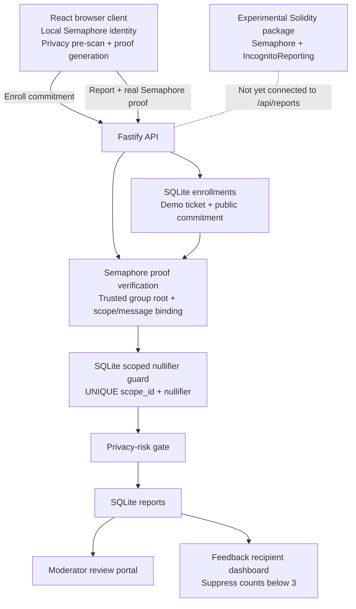

Incognito — Anonymous College Feedback & Reporting Platform
Prototype 1 · Privacy-focused college feedback with Semaphore zero-knowledge membership proofs
Incognito is a college feedback and reporting prototype intended to let eligible members submit feedback while proving group membership without revealing the secret behind their Semaphore identity. It combines a React frontend, a Fastify API, SQLite storage, privacy-risk checks, and an experimental Solidity/Semaphore contracts package.
> **Current status:** The frontend/backend prototype builds successfully and its 11 backend tests pass. Solidity contracts and a local Hardhat integration test are present. The contract submission flow is **not yet connected to the app's `/api/reports` route**, so the current UI report path is verified by the backend, not yet by the deployed reporting contract.
What works today
Semaphore identity and proof flow: The browser creates a Semaphore identity and generates a real Semaphore v4/Groth16 proof for a report scope and message.
Server-side proof verification: The backend reconstructs a Semaphore group from enrolled commitments, checks the submitted root, validates message/scope binding, and performs cryptographic proof verification.
Duplicate prevention: SQLite enforces a unique `(scope_id, nullifier)` pair. A repeated submission within the same scope is rejected with HTTP `409`; another scope produces a different Semaphore nullifier.
Privacy-risk checks: Submitted report content is scanned for patterns such as email addresses, phone numbers, student IDs, dates, rooms, and course-code context. Findings can cause redaction or manual review.
Moderator and recipient views: The app includes moderator review and aggregated feedback views. Aggregate summaries are suppressed when fewer than three approved contributors exist in a scope.
Experimental blockchain package: The `blockchain/` folder contains `IncognitoReporting.sol`, Semaphore deployment wrappers, an Ignition deployment module, and a local proof/contract integration test.
Important boundaries and prototype limitations
This is a prototype, not a production anonymity guarantee.
Enrollment is demo-only: The current enrollment service accepts tickets beginning with `STU` or `DEMO`; it does not verify a ticket against an authoritative college registry. Do not present this as institutional identity verification.
Enrollment records contain linkable data: SQLite stores the demo student ticket together with the public Semaphore identity commitment in the enrollment table. Report records do not store the identity secret, but the enrollment table is not anonymous from an administrator with database access.
The identity secret is stored in browser `localStorage`: This is convenient for the demo but is not the preferred storage choice for a hardened production application, especially on shared devices.
IP/network anonymity is not provided by the app: Server logs, network metadata, request timing, a user's writing, or operational correlation can reveal information. A zero-knowledge proof by itself does not hide these signals.
Threshold suppression is not differential privacy: The minimum-three-contributor rule suppresses small cohorts; it does not add calibrated statistical noise or provide a differential-privacy guarantee.
On-chain reporting is not wired into the current API: The Solidity contract expects `proof.scope` to equal a numeric topic ID, while the existing app generates a scope from values such as `teaching:2026-Q4` and hashes that string. A consistent scope/topic mapping and group synchronization are still required before reports can be submitted through the contract.
Use a local test chain until configured: The contract package does not automatically configure the Semaphore group and topics merely by deploying the contracts. Do not claim a report was accepted on-chain unless the transaction was actually sent and confirmed.
Architecture

Technology stack
Frontend: React 18, TypeScript, Vite, Tailwind CSS, Lucide React, Recharts.
Backend: Node.js, Fastify, TypeScript, SQLite via `better-sqlite3`, Zod.
Zero-knowledge: Semaphore protocol v4 packages, Groth16 proof generation/verification, `snarkjs`/WASM artifacts.
Blockchain package: Solidity, Hardhat 3, Hardhat Ignition, Viem, Semaphore contracts.
Tests: Vitest for backend integration tests; Hardhat Node.js tests for contracts.
Prerequisites
Node.js 22.x recommended for the tested setup
npm 10.x recommended
Setup and run
From the repository root:
```bash
npm run setup
```
Seed demo data if needed:
```bash
npm run seed
```
Start the frontend and backend in development mode:
```bash
npm run dev
```
The current README/configuration expects the frontend at `http://localhost:3000` and backend at port `3001`. If your local configuration differs, use the actual Vite and server startup output.
Run the backend tests:
```bash
npm test
```
Build both applications:
```bash
npm run build
```
Backend API
`POST /api/enroll`
Enrolls a public identity commitment using the current demo ticket check.
Request:
```json
{
  "studentTicket": "STU-2026-8891",
  "identityCommitment": "<decimal Semaphore identity commitment>"
}
```
The current implementation only checks that the ticket begins with `STU` or `DEMO`; it is not a real college registry verification flow.
`GET /api/group/state`
Returns the backend's current enrolled commitments, reconstructed Merkle root, and tree depth. This is currently the backend/SQLite group state, not proof that those members have already been synchronized to the blockchain group.
`POST /api/reports`
Submits a report with a real Semaphore proof object. Report content remains off-chain in SQLite.
Request shape:
```json
{
  "category": "teaching",
  "scopeId": "teaching:2026-Q4",
  "content": "Lecture slides could use more worked examples.",
  "proof": {
    "merkleTreeDepth": 16,
    "merkleTreeRoot": "<decimal Merkle root>",
    "nullifier": "<decimal nullifier>",
    "message": "<decimal message signal>",
    "scope": "<decimal scope signal>",
    "points": ["<proof coordinate values>"]
  }
}
```
Typical responses:
`201 Created` — proof accepted; report stored and classified.
`400 Bad Request` — malformed payload or invalid category/scope relationship.
`401 Unauthorized` — proof, scope, message, or group-root verification failed.
`409 Conflict` — duplicate nullifier already used for that scope.
`GET /api/admin/reports`
Retrieves reports for authorized moderators. Check `server/src/routes/admin.ts` for the current demo authentication configuration. Replace any demo/static credentials before deploying outside a local demonstration.
`PATCH /api/admin/reports/:id`
Updates a report's review status and optionally its sanitized content.
`GET /api/feedback/summary`
Returns grouped feedback summaries. Results are suppressed when fewer than three approved contributors exist in a category/scope.
`GET /api/health`
Returns backend health status.
> The old `/api/verification/demo` simulated-proof endpoint is no longer part of the current server route setup. The current report API accepts a full Semaphore proof object instead of the old `proofToken`/`nullifier` demonstration payload.
Blockchain package status
The `blockchain/` directory contains:
`contracts/IncognitoReporting.sol` — topic management, Semaphore proof verification, and per-topic nullifier reuse protection.
`contracts/SemaphoreVerifierDeployable.sol` and `contracts/SemaphoreDeployable.sol` — deployable Semaphore wrappers.
`ignition/modules/Incognito.ts` — deploys PoseidonT3, the Semaphore verifier, Semaphore, and IncognitoReporting.
`test/SemaphoreIntegration.ts` — local test intended to deploy contracts, generate a genuine proof, submit it, and verify on-chain nullifier tracking.
From the blockchain folder, use:
```bash
cd blockchain
npm ci
npx hardhat compile
npx hardhat test nodejs
```
Before calling this end-to-end blockchain integrated
Decide on a canonical mapping from each backend scope (for example `teaching:2026-Q4`) to a numeric on-chain topic ID.
Generate the proof using the same scope signal accepted by the contract.
Keep the backend and on-chain Semaphore group memberships and roots synchronized.
Configure `IncognitoReporting` with the deployed Semaphore address and group ID, and create the topics.
Add the on-chain transaction path to report submission and persist transaction status/hash without putting report text on-chain.
Test successful submission, invalid proof, inactive topic, duplicate nullifier, and a second scope/topic.
Frontend review notes
The report submission page has a sensible sequence: local identity, demo enrollment, category/period selection, privacy pre-scan, proof generation, then report submission. Before production, consider these improvements:
Replace wording such as “Zero identity linkage” with a qualified claim explaining that the proof hides the identity secret but does not hide network metadata or operational correlation.
Clearly label the student ticket as a demo eligibility check.
Avoid displaying sensitive secret material; store browser identity data with a security model suitable for the intended deployment.
`client/src/workers/zkProofWorker.ts` exists, but `SubmitReportPage.tsx` currently imports and calls `generateProof` directly. If the worker is intended to offload proof generation, wire it into the page and test the worker path.
Add a visible confirmation of the on-chain transaction only after the contract transaction has actually been submitted and confirmed.
Test status
Last reported local results during development:
Backend: 11/11 Vitest tests passing, including real Semaphore proof acceptance/rejection, altered proof rejection, message binding, scoped nullifier duplicate protection, concurrent duplicate handling, privacy checks, moderator authorization, and report identity-leak checks.
Production build: Backend TypeScript and frontend TypeScript/Vite build completed successfully. Vite emitted a large-chunk optimization warning; it did not fail the build.
Blockchain: The local Hardhat suite previously passed 12 tests in the standalone blockchain project. Re-run the commands above after pulling the branch to confirm the current checkout.
Privacy and security statement
Incognito demonstrates zero-knowledge membership proofs and scope-specific nullifiers in a prototype. It does not, by itself, guarantee that a reporter cannot be identified. For a production deployment, the team must add authoritative eligibility verification, protect enrollment records, secure identity-secret handling, review logs and network metadata, configure robust authentication, synchronize contract state, and conduct a security review.
License
MIT License (see the repository license file, if included).