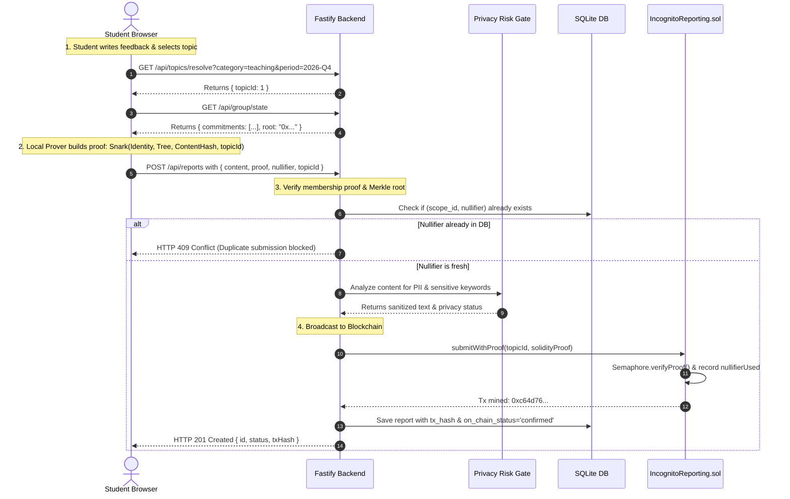

# Incognito: Anonymous College Feedback & Reporting Platform
## Complete System Architecture, Features, and Working Guide

---

## 1. Introduction & Problem Statement

### The Problem
In academic and college environments, students often hesitate to share honest feedback regarding faculty, grading discrepancies, administrative bottlenecks, or campus facilities. The two main reasons are:
1. **Fear of Academic Retaliation:** Students fear grades or opportunities will be jeopardized if feedback is tied to their student ID or name.
2. **Lack of Trust in "Anonymous" Surveys:** Traditional Google Forms or internal survey portals ask for logins or log IP addresses, timestamps, and account sessions, leaving students skeptical about true anonymity.
3. **The Spam & Manipulation Paradox:** If a survey is completely open with zero authentication, bad actors or bots can spam submissions or submit hundreds of bogus complaints to manipulate department evaluations.

### The Solution: Incognito
**Incognito** solves the trilemma of **Authenticity**, **True Anonymity**, and **Spam Prevention** using **Zero-Knowledge Cryptography (Semaphore Protocol V4)** and **Blockchain Verification (Solidity + Hardhat)**:
- **Verified Members Only:** Only genuine enrolled students with valid college tickets can submit feedback.
- **Mathematically Provable Anonymity:** Neither the college administration, database admins, nor anyone watching the blockchain can discover *which* student submitted a particular report.
- **Scoped Double-Submission Prevention:** A student can only submit **one feedback per topic per evaluation period** (e.g. 1 review for "Data Structures" in "2026-Q4"). Submitting twice to the same topic is cryptographically blocked, yet their submissions across different topics remain completely unlinkable.
- **Automated Privacy Risk Gate:** A privacy scanning layer strips accidental self-identifying details (emails, phone numbers, specific makeup test dates) before feedback is published to aggregated dashboards.

---

## 2. Core Concepts Explained from the Ground Up

Before diving into the code, here are the core cryptographic and system concepts explained simply:

### A. Zero-Knowledge Proof (ZK-SNARK)
A Zero-Knowledge Proof allows a person (the *Prover*) to mathematically prove to another person (the *Verifier*) that a statement is true, **without revealing any information beyond the validity of the statement**.

> **Analogy:** Imagine a cave with a secret door that opens only with a secret password. You want to prove to a friend that you know the password without telling them what the password is. You walk into the cave, open the door, and walk out from the opposite exit. Your friend knows with 100% certainty that you know the password, but they still don't know the password itself.

### B. Semaphore Identity & Identity Commitment
When a student logs in with their student ticket:
1. The student's device generates a random secret key called a **Semaphore Identity** (consisting of a `trapdoor` and a `nullifier`). This secret never leaves the student's browser.
2. From this secret, a public cryptographic hash called the **Identity Commitment** is computed.
3. The college only receives and records the **Identity Commitment** in its verified student roster. The secret itself remains strictly on the student's device.

### C. The Merkle Tree (Group Membership)
All enrolled student identity commitments are inserted as leaves into a cryptographic data structure called a **Merkle Tree**:
- Every pair of leaves is hashed together to create parent nodes, which are hashed again up to a single top value: the **Merkle Root**.
- To prove they are an enrolled student, the student generates a zk-SNARK proof demonstrating:
  *"I know a secret identity whose commitment is a valid leaf inside this Merkle Tree with root X."*
- Anyone can verify the proof against the Merkle Root, confirming the submitter is an enrolled student, without knowing *which leaf* belongs to them.

### D. The Magic of Nullifiers (Preventing Duplicates Without Tracking)
If the system doesn't know who you are, how can it stop you from submitting 100 complaints?
This is solved by a mathematical construct called a **Nullifier Hash**:
$$\text{Nullifier} = \text{PoseidonHash}(\text{Student's Secret}, \text{Topic Scope ID})$$

Key properties of the Nullifier:
1. **Deterministic for the same topic:** If Student A generates a proof for Topic 1, the nullifier is always $N_1$. If Student A tries to submit a second time for Topic 1, the proof produces the identical $N_1$. The database and smart contract see $N_1$ has already been used and reject the submission with **409 Conflict** (`NullifierAlreadyUsed`).
2. **Completely different across topics:** If Student A submits feedback for Topic 2, the proof produces an entirely different, unlinkable value $N_2$. Nobody can determine that $N_1$ and $N_2$ came from the same student.
3. **One-Way:** You cannot reverse the nullifier to discover the student's identity.

### E. Topic Scoping (`scopeId` and `topicId`)
In Incognito, every feedback window is scoped by category and time window:
- String Scope: `teaching:2026-Q4`, `facilities:2026-Q4`, `curriculum:2026-Q4`
- Numeric Scope: On-chain, topics are assigned unique IDs (`topicId = 1, 2, 3...`)
- Both the off-chain engine and the Solidity smart contract enforce that `proof.scope == topicId`.

---

## 3. High-Level System Architecture

Incognito is organized into four interconnected tiers:

```
┌────────────────────────────────────────────────────────────────────────┐
│                          USER's BROWSER                                │
│                                                                        │
│   ┌───────────────────────────┐    ┌───────────────────────────────┐   │
│   │ React 18 / Vite Frontend  │    │ In-Browser Semaphore Prover   │   │
│   │ - Submit Feedback Form    │◄───┤ - Generates Groth16 zk-SNARK  │   │
│   │ - Analytics & Dashboards  │    │ - Secrets never leave device  │   │
│   └─────────────┬─────────────┘    └───────────────────────────────┘   │
└─────────────────┼──────────────────────────────────────────────────────┘
                  │ HTTPS / JSON-RPC
┌─────────────────▼──────────────────────────────────────────────────────┐
│                    INCIGNITO BACKEND ENGINE (Fastify)                  │
│                                                                        │
│   ┌───────────────────────────┐    ┌───────────────────────────────┐   │
│   │    REST API Endpoints     │    │   Off-Chain ZK Verifier       │   │
│   │    /api/enroll, /reports  │───►│   - Validates Snark proof     │   │
│   │    /api/topics, /feedback │    │   - Checks root against group │   │
│   └─────────────┬─────────────┘    └───────────────┬───────────────┘   │
│                 │                                  │                   │
│   ┌─────────────▼─────────────┐    ┌───────────────▼───────────────┐   │
│   │  Privacy Risk Gate        │    │      Topic Registry           │   │
│   │  - PII Detection & Stripping│  │  - Maps scope string to ID    │   │
│   │  - Harassment/Safety Flags│    │  - Manages active semesters   │   │
│   └─────────────┬─────────────┘    └───────────────┬───────────────┘   │
│                 │                                  │                   │
│   ┌─────────────▼─────────────┐    ┌───────────────▼───────────────┐   │
│   │ SQLite Storage (Embedded) │    │   Viem Blockchain Service     │   │
│   │ - Nullifiers, Reports     │    │   - Interacts with contracts  │   │
│   │ - Topics, Commitments     │    │   - Submits txs with gas      │   │
│   └───────────────────────────┘    └───────────────┬───────────────┘   │
└────────────────────────────────────────────────────┼───────────────────┘
                                                     │ JSON-RPC (Port 8545)
┌────────────────────────────────────────────────────▼───────────────────┐
│                     ETHEREUM SMART CONTRACTS (Hardhat)                 │
│                                                                        │
│   ┌───────────────────────────┐    ┌───────────────────────────────┐   │
│   │    PoseidonT3 Library     │◄───┤    Semaphore Core Group       │   │
│   │    Cryptographic ZK Hash  │    │    On-chain tree & membership │   │
│   └───────────────────────────┘    └───────────────┬───────────────┘   │
│                                                    │                   │
│   ┌───────────────────────────┐                    ▼                   │
│   │ SemaphoreVerifierDeployable│◄───┌───────────────────────────────┐  │
│   │ On-chain Snark verifier   │    │ IncognitoReporting.sol        │  │
│   └───────────────────────────┘    │ - Enforces proof.scope=topicId│  │
│                                    │ - Records nullifierUsed mapping│ │
│                                    │ - Emits Accepted event        │  │
│                                    └───────────────────────────────┘  │
└────────────────────────────────────────────────────────────────────────┘
```

---

## 4. Detailed Feature Breakdown

### Feature 1: Student Enrollment & Ticket Redemption
* **Purpose:** Ensures only verified students can participate, while severing any link between student records and subsequent feedback.
* **Working:**
  1. The student provides their college ticket number (e.g. `STU-ALICE-101`).
  2. The browser generates a unique Semaphore identity and derives the identity commitment.
  3. The backend checks if the ticket is valid and not already enrolled.
  4. The identity commitment is stored in the college roster and synced to the on-chain Semaphore contract.
  5. The student ticket is marked as redeemed. The student retains their secret identity locally in browser `localStorage`.

### Feature 2: In-Browser Cryptographic Proof Generation
* **Purpose:** True zero-knowledge guarantees require that the proof is constructed on the client device.
* **Working:**
  1. Before submission, the frontend queries `/api/group/state` to obtain all enrolled commitments.
  2. The frontend queries `/api/topics/resolve` to receive the official numeric `topicId`.
  3. Using WebAssembly, the client builds the Merkle tree and compiles a Groth16 ZK-SNARK proof with:
     - `merkleTreeDepth` (depth of the tree)
     - `merkleTreeRoot` (current root of enrolled students)
     - `nullifier` (unique one-way topic-specific nullifier)
     - `message` (cryptographic hash of report content)
     - `scope` (the numeric topic ID)
     - `points` (elliptic curve coordinates of the SNARK proof)

### Feature 3: Scoped Nullifier Duplicate Prevention
* **Purpose:** Prevents ballot stuffing and coordinated spam.
* **Working:**
  1. When a report is received, the server checks the `nullifiers` table for `(scope_id, nullifier)`.
  2. If found, the submission immediately aborts with `HTTP 409 Conflict` ("Duplicate submission for this scope").
  3. If new, the nullifier is stored in the database and submitted to the blockchain contract where `nullifierUsed[topicId][nullifier] = true` is set permanently in EVM storage.

### Feature 4: Privacy Risk Gate & Automated PII Sanitization
* **Purpose:** Even if the ZK proof is anonymous, students might unintentionally deanonymize themselves by writing:
  *"Please call me back at 555-0199 or email me at john@college.edu regarding my makeup test on Oct 12th in Room 402."*
* **Working:**
  The [`PrivacyRiskGate`](file:///c:/Users/dilly/OneDrive/Desktop/Joel/BITNBUILD/LimitBreakers_college_round/server/src/services/privacyGate.ts) runs heuristic regex analyzers before reports are stored:
  - **Phone Numbers:** Replaced with `[PHONE REDACTED]`
  - **Email Addresses:** Replaced with `[EMAIL REDACTED]`
  - **Student IDs (`STU-XXXX`):** Replaced with `[STUDENT ID REDACTED]`
  - **Temporal & Micro-Contexts:** Specific times/dates with small attendee groups are flagged for manual moderator review.
  - **Status Assignments:**
    - `approved_for_aggregation`: Clean feedback, ready for public dashboard.
    - `needs_sanitization`: Minor PII stripped, sanitized version created.
    - `held_for_privacy_review`: High risk of deanonymization; held for moderator approval.

### Feature 5: Serious Allegation Detection
* **Purpose:** Feedback systems should not bury reports of sexual harassment, threats, or severe ethical violations into casual aggregations.
* **Working:**
  - Content is analyzed against serious grievance lexicons.
  - Reports identified as severe are tagged with `isSeriousAllegation = 1`.
  - These are isolated in the Moderator Dashboard for immediate administrative triage without compromising the student's anonymity.

### Feature 6: Aggregated Analytics & k-Anonymity (Differential Privacy Threshold)
* **Purpose:** If only one student submits feedback for a tiny elective course with 3 students, the professor could easily guess who wrote it.
* **Working:**
  - The [`feedback.ts`](file:///c:/Users/dilly/OneDrive/Desktop/Joel/BITNBUILD/LimitBreakers_college_round/server/src/routes/feedback.ts) summary route enforces a **Minimum Contributor Threshold ($k=3$)**.
  - If fewer than 3 unique students have submitted feedback for a specific category/scope, the text excerpts and detailed scores are **suppressed**:
    > *"Results suppressed: Contributor count (2) is below the required privacy threshold of 3 contributors."*

### Feature 7: On-Chain Smart Contract Verification
* **Purpose:** College administrations could theoretically tamper with their database to delete unfavorable reviews. Blockchain validation provides an immutable, verifiable public log.
* **Working:**
  - After off-chain verification, the backend calls `submitWithProof(topicId, proof)` on [`IncognitoReporting.sol`](file:///c:/Users/dilly/OneDrive/Desktop/Joel/BITNBUILD/LimitBreakers_college_round/blockchain/contracts/IncognitoReporting.sol).
  - The smart contract invokes Semaphore's `verifyProof(groupId, proof)`.
  - Upon success, an EVM event `AnonymousSubmissionAccepted(topicId, nullifier)` is emitted and the transaction hash is permanently pinned to the report.

### Feature 8: Graceful Fallback Mode (Dual Execution)
* **Purpose:** Hackathon prototypes and production systems must be resilient to RPC node outages or high gas costs.
* **Working:**
  - If the blockchain RPC is unreachable or gas estimation fails, the backend does **not** reject the student's submission.
  - The report is marked with `on_chain_status = 'failed'` (or `'off_chain_only'` if no RPC is configured) while keeping the database record intact.
  - The student's voice is always heard.

---

## 5. Technology Stack Summary

| Layer | Technology | Role |
| :--- | :--- | :--- |
| **Frontend UI** | React 18, Vite | Component architecture & fast HMR bundling |
| **UI Design System** | Tailwind CSS, Lucide Icons | Responsive modern styling & icons |
| **Charts & Graphs** | Recharts | Department sentiment, feedback trends & volume charts |
| **ZK Prover** | `@semaphore-protocol/proof` | Browser-based Groth16 witness and proof computation |
| **ZK Cryptography** | Semaphore V4, snarkjs | Merkle trees, Poseidon hashing, and ZK membership circuits |
| **Backend Framework**| Fastify, TypeScript | Ultra-fast HTTP API server with native JSON serialization |
| **Database Engine** | Node.js `node:sqlite` (`DatabaseSync`) | Embedded zero-dependency synchronous SQLite in WAL mode |
| **Data Validation** | Zod | Strict schema validation for payloads & SNARK proofs |
| **Smart Contracts** | Solidity 0.8.34 | EVM smart contracts with custom errors and gas optimization |
| **Blockchain Tooling**| Hardhat 3 | Local EDR Ethereum node and deployment pipeline |
| **Web3 Client** | Viem | Modern TypeScript Ethereum interface for contract calls |

---

## 6. End-to-End Report Submission Lifecycle

The complete flow of a report from keystroke to blockchain confirmation:



---

## 7. Database Schema Reference

The database operates with four relational tables in `server/incognito.db`:

```sql
-- Enrolled Student Commitments (no names, emails, or passwords)
CREATE TABLE enrollments (
  id TEXT PRIMARY KEY,
  identity_commitment TEXT NOT NULL UNIQUE,
  student_ticket TEXT NOT NULL,
  created_at TEXT NOT NULL
);

-- Active Evaluation Topics
CREATE TABLE topics (
  id INTEGER PRIMARY KEY AUTOINCREMENT,
  name TEXT NOT NULL,
  category TEXT NOT NULL,
  period TEXT NOT NULL,
  active INTEGER NOT NULL DEFAULT 1,
  created_at TEXT NOT NULL,
  UNIQUE(category, period)
);

-- Cryptographic Nullifier Tracking (Prevents duplicate reports)
CREATE TABLE nullifiers (
  id TEXT PRIMARY KEY,
  scope_id TEXT NOT NULL,
  nullifier TEXT NOT NULL,
  created_at TEXT NOT NULL,
  UNIQUE(scope_id, nullifier)
);

-- Submitted Reports (Completely detached from student identity)
CREATE TABLE reports (
  id TEXT PRIMARY KEY,
  category TEXT NOT NULL,
  scope_id TEXT NOT NULL,
  topic_id INTEGER,
  content TEXT NOT NULL,
  sanitized_content TEXT,
  status TEXT NOT NULL, -- 'approved_for_aggregation', 'needs_sanitization', 'held_for_privacy_review'
  privacy_flags TEXT NOT NULL, -- JSON array of detected risks
  is_serious_allegation INTEGER NOT NULL DEFAULT 0,
  tx_hash TEXT,
  on_chain_status TEXT NOT NULL DEFAULT 'off_chain_only', -- 'confirmed', 'off_chain_only', 'failed'
  created_at TEXT NOT NULL,
  updated_at TEXT NOT NULL
);
```

---

## 8. Summary of API Endpoints

| Method | Endpoint | Description |
| :--- | :--- | :--- |
| `POST` | `/api/enroll` | Validates a student ticket and registers their Semaphore identity commitment |
| `GET` | `/api/group/state` | Returns the current list of commitments, Merkle root, and tree depth |
| `GET` | `/api/topics` | Lists all feedback topics and active statuses |
| `GET` | `/api/topics/resolve` | Resolves `category` + `period` to the official numeric `topicId` |
| `POST` | `/api/reports` | Verifies ZK proof, scans PII, prevents duplicates, and submits on-chain |
| `GET` | `/api/feedback/summary`| Retrieves aggregated feedback with $k$-anonymity threshold suppression |
| `GET` | `/api/admin/reports` | Moderator route for inspecting held reports and sanitization status |
| `POST` | `/api/admin/reports/:id/sanitize` | Moderator route to approve or redact held feedback |
| `GET` | `/api/health` | Service health status and cryptographic verification mode |

---

## 9. Conclusion

**Incognito** proves that privacy and accountability do not have to be mutually exclusive. By leveraging **Semaphore V4 zk-SNARKs**, **Hardhat smart contracts**, and an **automated Privacy Risk Gate**, educational institutions can foster authentic student feedback while guaranteeing protection against retaliation, impersonation, and spam.
